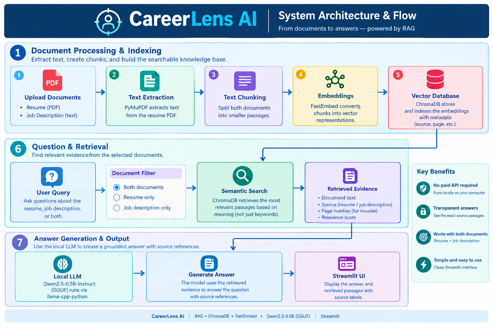

* Join our Whatsaap channel to access daily up-to-date upskilling material on python, ai, ai agents and machine learning. Join to become job ready for free. 📱 **WhatsApp Channel:** [Follow us for AI updates](https://whatsapp.com/channel/0029VbARpEB7T8bYWCeDN61H)

# 🎯 CareerLens AI — Evidence-Based Career Assistant

**CareerLens AI** is an AI-powered career assistant that uses Retrieval-Augmented Generation (RAG) to answer questions about a candidate's resume and a job description.

Upload a resume in PDF format, paste a job description, and ask questions in natural language. CareerLens AI retrieves relevant passages from the documents and uses a small language model to generate answers with source references.

The goal is to make resume analysis more transparent by connecting answers to the actual document evidence.

## ✨ Features

* 📄 **Resume Question Answering:** Ask questions about skills, education, experience, projects, and qualifications mentioned in your resume.
* 💼 **Job Description Analysis:** Understand job responsibilities, required skills, qualifications, and experience requirements.
* 🔍 **Resume–Job Comparison:** Explore which job requirements are supported by your resume and which are not found in the retrieved evidence.
* 📚 **Evidence-Based Answers:** View retrieved passages to help verify generated answers.
* 📌 **Source References:** Resume passages include PDF page numbers, while job-description passages are labelled by source.
* 🧠 **Semantic Search:** Retrieve relevant information based on meaning rather than exact keyword matches alone.
* 🤖 **Local Language Model:** Run Qwen2.5-0.5B-Instruct GGUF locally through `llama-cpp-python`, without requiring Ollama or a paid LLM API.
* 🌐 **Interactive Web Interface:** Use the application through Streamlit.

## 🧠 How It Works

CareerLens AI follows a Retrieval-Augmented Generation (RAG) pipeline.

1. **Upload documents:** Upload your resume as a PDF and paste the job description.
2. **Extract text:** PyMuPDF extracts readable text from the resume.
3. **Split into chunks:** Divide the documents into smaller passages.
4. **Create embeddings:** FastEmbed converts the passages into numerical representations.
5. **Store and retrieve:** ChromaDB stores the passages and retrieves content relevant to the user's question.
6. **Generate an answer:** The local language model uses retrieved evidence to answer the question.
7. **Verify the evidence:** Review the answer alongside the retrieved passages and source references.

### 🏗️ System Architecture

The following diagram illustrates the complete CareerLens AI pipeline, from document processing and semantic retrieval to local LLM-based answer generation.



## Pipeline Overview

1. Document Processing: Extract text from the resume PDF and accept the job description.

2. Text Chunking: Split both documents into smaller passages.

3. Embeddings: Use FastEmbed to convert passages into vector representations.

4. Vector Database: Store and retrieve relevant passages using ChromaDB.

5. Semantic Retrieval: Find evidence relevant to the user's question.

6. Answer Generation: Use the local Qwen2.5-0.5B-Instruct model to generate a grounded response.

7. Evidence Display: Show the answer and retrieved source passages through Streamlit.

## 🛠️ Technology Stack

| Component       | Technology                 | Purpose                        |
| --------------- | -------------------------- | ------------------------------ |
| User interface  | Streamlit                  | Interactive web application    |
| PDF processing  | PyMuPDF                    | Extract text from resumes      |
| Text splitting  | LangChain Text Splitters   | Divide documents into chunks   |
| Embeddings      | FastEmbed                  | Convert text into vectors      |
| Vector database | ChromaDB                   | Store and retrieve passages    |
| Language model  | Qwen2.5-0.5B-Instruct GGUF | Generate answers locally       |
| LLM inference   | llama-cpp-python           | Run the GGUF model from Python |
| Model download  | Hugging Face Hub           | Download the model file        |

## 📋 Example Questions

### Questions about a resume

* What technical skills are mentioned in my resume?
* What projects have I worked on?
* Does my resume provide evidence of Python experience?
* What qualifications are listed in my resume?

### Questions about a job description

* What are the main responsibilities of this position?
* Which technical skills are required?
* What qualifications does the employer expect?
* Does this role require machine learning experience?

### Questions about both documents

* Which job requirements are supported by my resume?
* Which required skills are not found in my resume?
* Does my resume provide evidence of machine learning experience?
* How can I improve my resume for this position?

## 🚀 Getting Started

### Prerequisites

* Python 3.10 or 3.11 recommended
* Git
* Internet access for installing packages and downloading the model
* Sufficient RAM to run the embedding model and local language model

Performance depends on your computer. The small quantized model is intended for resource-constrained systems, but response speed and answer quality may vary.

### 1. Clone the Repository

Replace `YOUR-USERNAME` with your GitHub username.

```bash
git clone https://github.com/YOUR-USERNAME/CareerLens-AI.git
cd CareerLens-AI
```

### 2. Create a Virtual Environment

**Windows:**

```powershell
python -m venv .venv
.venv\Scripts\activate
```

**macOS / Linux:**

```bash
python3 -m venv .venv
source .venv/bin/activate
```

### 3. Install Dependencies

```bash
python -m pip install --upgrade pip
pip install -r requirements.txt
```

If `llama-cpp-python` fails to install on Windows, consult its installation documentation for the appropriate CPU wheel or build requirements.

### 4. Download the Language Model

Run:

```bash
python download_model.py
```

This script downloads the quantized Qwen2.5-0.5B-Instruct GGUF model into the `models/` directory.

The model file is not included in this GitHub repository.

### 5. Launch the Application

```bash
streamlit run app.py
```

Open the local URL displayed in your terminal, typically:

`http://localhost:8501`

### 6. Use CareerLens AI

1. Upload your resume PDF.
2. Paste the job description.
3. Click **Build / Update Knowledge Base**.
4. Select **Both documents**, **Resume only**, or **Job description only**.
5. Enter your question and click **Ask CareerLens AI**.
6. Expand **View retrieved evidence** to inspect the supporting passages.

Rebuild the knowledge base whenever you change the documents.

## 📁 Project Structure

```text
CareerLens-AI/
├── app.py                 # Streamlit application and RAG pipeline
├── download_model.py      # Downloads the local GGUF model
├── requirements.txt       # Python dependencies
├── .gitignore             # Files excluded from Git
├── README.md              # Project documentation
├── assets/
│   └── careerlens-architecture.png
└── models/
    └── .gitkeep           # Keeps the empty model directory in Git
```

## ⚠️ Limitations

* The small language model may generate incomplete or incorrect answers.
* Retrieved passages may not contain all the information needed to answer a question.
* A skill not found in retrieved evidence is not necessarily absent from the full resume.
* The application does not independently verify whether a candidate genuinely possesses a skill.
* Scanned PDFs may require OCR if they do not contain extractable text.
* The current version provides document-based question answering, not a complete automated recruitment or hiring decision system.

Always verify important answers against the original documents.

## 🔮 Future Improvements

* Automated skill matching and skill-gap reports.
* Resume improvement suggestions based on job requirements.
* Downloadable PDF or Markdown analysis reports.
* Persistent vector storage across application restarts.
* Support for DOCX resumes and multiple job descriptions.
* Evaluation of retrieval accuracy and answer quality.
* Optional integration with larger language models.

## 🎓 Learning Outcomes

This project demonstrates practical implementation of:

* Retrieval-Augmented Generation (RAG)
* Semantic search and vector databases
* Text embeddings and document chunking
* Local quantized language model inference
* Source-grounded question answering
* Streamlit application development

## 🤝 Contributing

Suggestions, bug reports, and improvements are welcome!

1. Fork this repository.
2. Create a new branch for your changes.
3. Make your improvements.
4. Submit a pull request.

## 📢 Connect With Us

Want more updates on **Artificial Intelligence, Machine Learning, Data Science, and practical AI projects**? Follow us!

* 📱 **WhatsApp Channel:** [Follow us for AI updates](https://whatsapp.com/channel/0029VbARpEB7T8bYWCeDN61H)
* 📸 **Instagram:** [Follow us on Instagram](https://www.instagram.com/thecareergram?igsh=M2l2Y2lpcHZ4ZjVj)
* 💻 **GitHub:** Explore more projects and learning resources on our GitHub profile.

⭐ If you find CareerLens AI useful, please consider giving this repository a **star** and sharing it with others!

💡 Follow us to learn, build, and grow together in AI and Data Science.

## 📄 License

This repository does not yet specify a license. Add a suitable open-source license before inviting reuse or redistribution. Check the selected language model's license and the licenses of its dependencies separately.

---

**CareerLens AI — Helping candidates understand the connection between their experience and job requirements through document evidence.**

🚀 *Keep learning. Keep building. Keep growing!*
